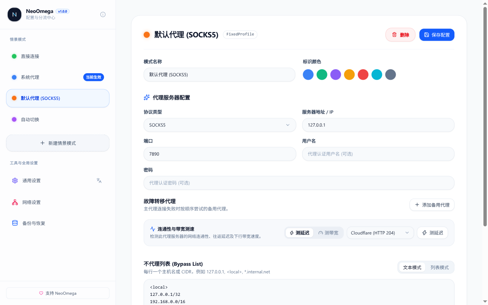

# NeoOmega (新一代现代化 Chrome 代理扩展)

> 为 Chrome 与现代化 Chromium 浏览器打造的高性能、无技术债代理管理与规则分流扩展（Manifest V3）。
> 作为 SwitchyOmega / ZeroOmega 的现代化重构接棒者，彻底告别旧时代 CoffeeScript、AngularJS 1.x 与 Grunt 架构。


<p align="center">
  <a href="https://chromewebstore.google.com/detail/neoomega-modern-proxy-man/cjkeldmnfoomnfciapmpjadoigjhbnjc"></a>
  <a href="https://microsoftedge.microsoft.com/addons/detail/neoomega-%E7%8E%B0%E4%BB%A3%E5%8C%96%E4%BB%A3%E7%90%86%E5%88%86%E6%B5%81%E6%89%A9%E5%B1%95/ocjkanamaifjjoknjhgjkgahaakaicpl"></a>
  <a href="https://addons.mozilla.org/zh-CN/firefox/addon/neoomega-modern-proxy-manager/"></a>
  <a href="https://github.com/izhimu/NeoOmega/releases"></a>
  <a href="LICENSE"></a>
</p>

## 安装与商店直达

| 平台 / 商店 | 安装直达 | 状态 |
| :--- | :--- | :--- |
| **Chrome 应用商店** | [👉 Chrome Web Store 直达](https://chromewebstore.google.com/detail/neoomega-modern-proxy-man/cjkeldmnfoomnfciapmpjadoigjhbnjc) | 已上架官方审核通过 |
| **Edge 扩展中心** | [👉 Microsoft Edge Add-ons 直达](https://microsoftedge.microsoft.com/addons/detail/neoomega-%E7%8E%B0%E4%BB%A3%E5%8C%96%E4%BB%A3%E7%90%86%E5%88%86%E6%B5%81%E6%89%A9%E5%B1%95/ocjkanamaifjjoknjhgjkgahaakaicpl) | 已上架官方审核通过 |
| **Firefox 附加组件** | [👉 Firefox Add-ons (AMO) 直达](https://addons.mozilla.org/zh-CN/firefox/addon/neoomega-modern-proxy-manager/) | 已上架官方审核通过 |
| **离线安装包 (Crx / Zip)** | [GitHub Releases 下载](https://github.com/izhimu/NeoOmega/releases) | 开源发布 |
---

## 核心特性与架构升级

- **纯粹的现代化技术栈**：基于 TypeScript + WXT (Vite 8) + Vue 3 打造，零历史包袱，代码量精简 80%，启动瞬时响应。
- **原生 Chrome Manifest V3**：
  - 彻底适配 Service Worker 休眠与按需唤醒生命周期，配置与状态由 `chrome.storage.local` 统一驱动。
  - 完整利用 `chrome.proxy.settings`、`chrome.webRequest.onAuthRequired`（代理认证）与 `chrome.webRequest.onErrorOccurred`。
- **完备的情景模式 (Profiles)**：
  - **直接连接 (Direct)**：不经由任何代理。
  - **系统代理 (System)**：直通操作系统网络代理配置。
  - **固定服务器 (Fixed)**：支持 HTTP / HTTPS / SOCKS4 / SOCKS5，带独立 Bypass 白名单。
  - **PAC 脚本 (PAC Script)**：支持在线 PAC 脚本 URL 或本地自定义 PAC 脚本。
  - **自动切换 (Switch Profile)**：支持域名通配符、URL 正则、CIDR IP 分段匹配以及 GFWList / AutoProxy 在线规则列表。
  - **虚情景模式 (Virtual Profile)**：指针别名，支持多处复用、一键重定向目标情景。
- **智能请求探测与一键加规则**：
  - 实时捕获当前标签页由于连接重置、超时、DNS 解析失败等产生的错误资源。
  - 插件图标动态 Badge 标红提醒，弹窗内一键将故障域名加入代理规则。
- **零门槛无痛迁移**：
  - 原生支持导入与解析 SwitchyOmega / ZeroOmega 的 `.bak` 备份文件，旧配置一键还原。
- **现代交互体验**：
  - 响应式深色/浅色自适应界面。
  - 支持 Chrome 现代化 Side Panel（侧边栏），常驻进行流量诊断与规则调试。
  - 首次安装自动打开新手操作指引（聚光灯定位真实按钮），配置页 logo 旁小图标可随时重看。
---

## 架构概览

```
NeoOmega/
├── entrypoints/
│   ├── background.ts            # MV3 Service Worker (生命周期事件、Alarm 定时更新、Badge 刷新)
│   ├── popup/                   # 工具栏弹窗 (快速切换模式、当前标签页规则展示与快速加规则)
│   ├── options/                 # 完整配置管理中心 (情景模式编辑、规则测试模拟器、备份与恢复)
│   └── sidepanel/               # Chrome 侧边栏 (实时网络监控与规则调试)
├── website/                     # 产品主页 (纯静态，无构建依赖)
├── src/
│   ├── core/
│   │   ├── types.ts             # 核心模型定义 (Profile, Rule, Condition, ProxyConfig)
│   │   ├── pac/
│   │   │   ├── generator.ts     # 轻量 PAC 脚本编译器 (将规则编译为高速 FindProxyForURL)
│   │   │   └── matcher.ts       # 规则匹配器 (通配符、正则、CIDR、白名单)
│   │   ├── parsers/
│   │   │   ├── switchyomega.ts  # SwitchyOmega .bak 解析与转换器
│   │   │   └── autoproxy.ts     # GFWList / AutoProxy base64 规则列表解析器
│   │   └── proxy/
│   │       ├── proxy-manager.ts # chrome.proxy.settings 调度与状态同步
│   │       └── auth-manager.ts  # webRequest.onAuthRequired 代理认证处理
│   └── storage/
│       └── storage.ts           # 类型安全的 chrome.storage 抽象与持久化驱动
```

---

## 界面预览



更多截图见 [screenshots/](screenshots/)，商店宣传图块见 [promo/](promo/)，产品主页源码见 [website/](website/)（可直接部署为 GitHub Pages）。

---

## 快速开始

### 依赖环境
- Node.js >= 20.0
- pnpm >= 9.0

### 本地开发
```bash
# 1. 安装依赖
pnpm install

# 2. 启动开发模式 (自动生成 .output/chrome-mv3 目录并支持热重载)
pnpm dev
```
打开 Chrome 访问 `chrome://extensions`，开启右上角「开发者模式」，点击「加载已解压的扩展程序」，选择项目根目录下的 `.output/chrome-mv3` 文件夹。

### 运行测试
```bash
pnpm test
```

### 构建生产包
```bash
pnpm build
```
编译产物输出至 `.output/chrome-mv3`，或运行 `pnpm zip` 直接打包为发布用压缩包。

---

## 赞助支持

NeoOmega 永久免费且开源。如果它帮助你从旧版扩展无痛迁移，欢迎请作者喝杯咖啡：

| 微信赞赏 | 支付宝 |
| :---: | :---: |
|  |  |
| 微信扫码 | 支付宝扫码 |

海外及信用卡用户可前往爱发电支持：

[](https://afdian.com/a/izhimu)
<!-- SPONSORS:START -->
还没有赞助者，来当第一个
<!-- SPONSORS:END -->

---

## 开源许可
MIT License.
